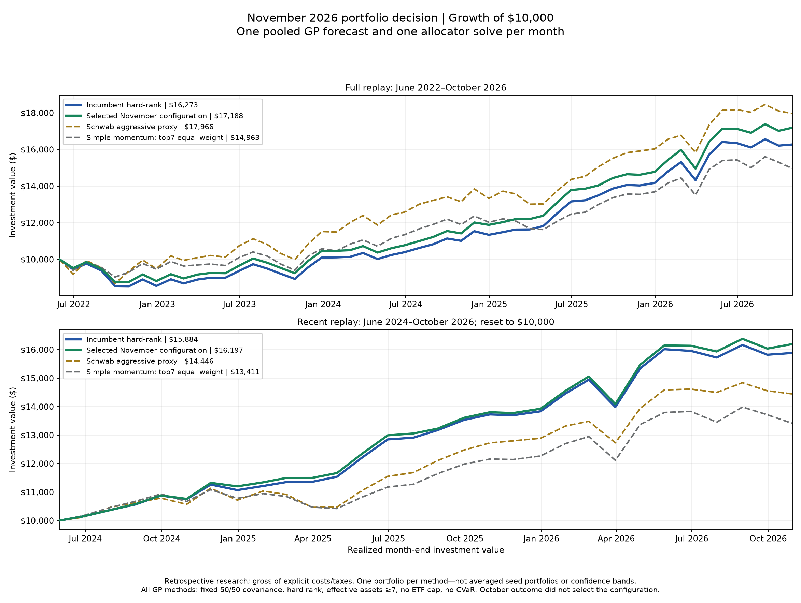

# Matched November configuration comparison

## Summary

Every GP row is one pooled forecast and one allocation per month—not a mean of seed portfolios.
The full panel contains 53 origins predicting June 2022--October 2026. October did not select the recommendation.

Apply fixed family prediction fractions, average means equally across seeds 27/127/227, average the approved 50/50 broad/compact observed covariance pool equally across those seeds, and allocate once. Every historical finalist is replayed with exactly this single-portfolio policy. The old research curves averaging three separately optimized seed portfolios are not used as its performance record.

GP rank 2/maxiter 15; t_index retained; raw hy_spread and its change excluded. Hard-rank allocation, long-only/full investment, effective assets ≥7, no ETF cap, and the unchanged causal historical-EW variance ceiling. Fixed 50/50 broad/compact covariance. No CVaR, uncertainty recalibration, continuous risk penalty, new forest blender, monthly discretionary blend selection, fallback weights or constraint relaxation.

## Frozen decision panel: 52 months through September 2026

6 finalists passed every frozen gate. The selected recipe is higher than each of the other 5 eligible recipes on all three 52-month objectives: Sharpe, cumulative return and rank IC. It is the sole eligible Pareto candidate; the closest-to-incumbent tie-break was not needed. Ineligible candidates were excluded by the recorded gates, even if an individual objective was higher.

For example, prior48_sharpe has slightly higher 52-month Sharpe (0.7265 versus 0.7213) and cumulative return (70.387% versus 70.177%), but fails `no_family_IC_loss_over_0p05`. prior48_return and prior48_ranking fail that same family noninferiority gate. The frozen rule deliberately rejects those tradeoffs; it does not simply pick the highest Sharpe.

| Configuration                                         |   Sharpe | Cumulative return   |   Rank IC | Frozen decision/status                                       |
|:------------------------------------------------------|---------:|:--------------------|----------:|:-------------------------------------------------------------|
| incumbent                                             |   0.6127 | 62.094%             |    0.1133 | Incumbent reference                                          |
| compromise                                            |   0.6293 | 63.849%             |    0.1296 | Failed: Sharpe gain ≥0.05; no family IC loss >0.05           |
| prior48_sharpe                                        |   0.7265 | 70.387%             |    0.1617 | Failed: no family IC loss >0.05                              |
| prior48_return                                        |   0.7184 | 70.111%             |    0.1615 | Failed: no family IC loss >0.05                              |
| prior48_ranking                                       |   0.7136 | 69.919%             |    0.165  | Failed: no family IC loss >0.05                              |
| shrink_prior48_sharpe_0.5                             |   0.6726 | 66.651%             |    0.1331 | All gates passed; selected is higher on all three objectives |
| average_prior48_sharpe_prior48_return_prior48_ranking |   0.7213 | 70.177%             |    0.1609 | Selected; all frozen gates passed                            |
| average_prior48_return_prior48_ranking                |   0.71   | 69.431%             |    0.1549 | All gates passed; selected is higher on all three objectives |
| average_prior48_sharpe_prior48_ranking                |   0.7097 | 69.213%             |    0.1585 | All gates passed; selected is higher on all three objectives |
| shrink_prior48_ranking_0.75                           |   0.6905 | 67.945%             |    0.1519 | All gates passed; selected is higher on all three objectives |
| FI48_[2, 3]_0.5                                       |   0.6692 | 66.222%             |    0.1389 | All gates passed; selected is higher on all three objectives |
| average_prior48_sharpe_prior48_return                 |   0.7169 | 69.941%             |    0.16   | Failed: no family IC loss >0.05                              |
| shrink_average48_0.75                                 |   0.6921 | 68.009%             |    0.1499 | Failed: no family IC loss >0.05                              |
| shrink_average48_0.5                                  |   0.6608 | 65.774%             |    0.1371 | Failed: Sharpe gain ≥0.05                                    |
| shrink_prior48_sharpe_0.75                            |   0.6924 | 67.861%             |    0.1466 | Failed: no family IC loss >0.05                              |

All 15 finalists are shown. Gate failures and eligible-but-dominated alternatives are different reasons for exclusion. The incumbent is a reference, not a failed challenger. October outcomes are excluded from this selection table; exact gate IDs and unrounded values are in COMPARISON.json.

## Full 53-month outcomes: June 2022–October 2026

| Configuration                                         | Selected   | Frozen gates passed   |   Sharpe | Cumulative return   | Rank IC   | Max drawdown   | October return   |
|:------------------------------------------------------|:-----------|:----------------------|---------:|:--------------------|:----------|:---------------|:-----------------|
| incumbent                                             | False      | False                 |    0.608 | 62.73%              | 0.113     | -14.64%        | 0.39%            |
| compromise                                            | False      | False                 |    0.621 | 64.27%              | 0.130     | -14.26%        | 0.25%            |
| prior48_sharpe                                        | False      | False                 |    0.734 | 72.21%              | 0.166     | -12.02%        | 1.07%            |
| prior48_return                                        | False      | False                 |    0.725 | 71.93%              | 0.165     | -12.36%        | 1.07%            |
| prior48_ranking                                       | False      | False                 |    0.714 | 71.15%              | 0.168     | -12.04%        | 0.72%            |
| shrink_prior48_sharpe_0.5                             | False      | True                  |    0.67  | 67.58%              | 0.135     | -13.39%        | 0.56%            |
| average_prior48_sharpe_prior48_return_prior48_ranking | True       | True                  |    0.727 | 71.88%              | 0.165     | -12.25%        | 1.00%            |
| average_prior48_return_prior48_ranking                | False      | True                  |    0.716 | 71.13%              | 0.159     | -12.31%        | 1.00%            |
| average_prior48_sharpe_prior48_ranking                | False      | True                  |    0.716 | 70.98%              | 0.162     | -12.39%        | 1.04%            |
| shrink_prior48_ranking_0.75                           | False      | True                  |    0.685 | 68.60%              | 0.153     | -12.68%        | 0.39%            |
| FI48_[2, 3]_0.5                                       | False      | True                  |    0.667 | 67.13%              | 0.141     | -13.23%        | 0.55%            |
| average_prior48_sharpe_prior48_return                 | False      | False                 |    0.724 | 71.76%              | 0.164     | -12.37%        | 1.07%            |
| shrink_average48_0.75                                 | False      | False                 |    0.689 | 68.93%              | 0.152     | -12.78%        | 0.55%            |
| shrink_average48_0.5                                  | False      | False                 |    0.658 | 66.70%              | 0.139     | -13.61%        | 0.56%            |
| shrink_prior48_sharpe_0.75                            | False      | False                 |    0.691 | 68.95%              | 0.149     | -12.74%        | 0.65%            |
| Schwab aggressive proxy                               | False      | Not applicable        |    0.676 | 79.66%              | —         | -13.14%        | -0.75%           |
| Simple momentum top7                                  | False      | Not applicable        |    0.446 | 49.63%              | —         | -9.65%         | -2.22%           |

The selected recipe is not a universal benchmark winner: over 53 months its cumulative return is 71.88%, versus 79.66% for Schwab aggressive. Its conventional Sharpe is 0.727, versus 0.676 for Schwab. Higher risk-adjusted performance did not mean higher ending wealth in this panel.

## Recent 29-month outcomes: June 2024–October 2026

| Configuration                                         | Selected   | Frozen gates passed   |   Sharpe | Cumulative return   | Rank IC   | Max drawdown   | October return   |
|:------------------------------------------------------|:-----------|:----------------------|---------:|:--------------------|:----------|:---------------|:-----------------|
| incumbent                                             | False      | False                 |    1.502 | 58.84%              | 0.283     | -6.42%         | 0.39%            |
| compromise                                            | False      | False                 |    1.495 | 58.99%              | 0.297     | -6.45%         | 0.25%            |
| prior48_sharpe                                        | False      | False                 |    1.579 | 61.51%              | 0.333     | -6.42%         | 1.07%            |
| prior48_return                                        | False      | False                 |    1.595 | 62.34%              | 0.339     | -6.45%         | 1.07%            |
| prior48_ranking                                       | False      | False                 |    1.548 | 60.73%              | 0.345     | -6.42%         | 0.72%            |
| shrink_prior48_sharpe_0.5                             | False      | True                  |    1.537 | 60.39%              | 0.305     | -6.39%         | 0.56%            |
| average_prior48_sharpe_prior48_return_prior48_ranking | True       | True                  |    1.588 | 61.97%              | 0.336     | -6.42%         | 1.00%            |
| average_prior48_return_prior48_ranking                | False      | True                  |    1.571 | 61.52%              | 0.332     | -6.42%         | 1.00%            |
| average_prior48_sharpe_prior48_ranking                | False      | True                  |    1.567 | 61.19%              | 0.336     | -6.42%         | 1.04%            |
| shrink_prior48_ranking_0.75                           | False      | True                  |    1.528 | 59.96%              | 0.326     | -6.36%         | 0.39%            |
| FI48_[2, 3]_0.5                                       | False      | True                  |    1.52  | 59.62%              | 0.307     | -6.42%         | 0.55%            |
| average_prior48_sharpe_prior48_return                 | False      | False                 |    1.592 | 62.16%              | 0.335     | -6.42%         | 1.07%            |
| shrink_average48_0.75                                 | False      | False                 |    1.546 | 60.61%              | 0.324     | -6.36%         | 0.55%            |
| shrink_average48_0.5                                  | False      | False                 |    1.52  | 59.86%              | 0.308     | -6.39%         | 0.56%            |
| shrink_prior48_sharpe_0.75                            | False      | False                 |    1.541 | 60.26%              | 0.314     | -6.36%         | 0.65%            |
| Schwab aggressive proxy                               | False      | Not applicable        |    1.052 | 44.46%              | —         | -6.02%         | -0.75%           |
| Simple momentum top7                                  | False      | Not applicable        |    0.769 | 34.11%              | —         | -6.42%         | -2.22%           |

Gate status refers to the frozen52-month decision panel, not a fresh test using October's return. Benchmarks are references, not eligible GP candidates. Returns are gross and cumulative.

## Earlier/later matched comparison

| Configuration                                         | Period                        |   Sharpe | Return   |   Rank IC | Max drawdown   | Average equity   |
|:------------------------------------------------------|:------------------------------|---------:|:---------|----------:|:---------------|:-----------------|
| incumbent                                             | Jun 2022–May 2024 (24 months) |   -0.187 | 2.45%    |    -0.092 | -14.64%        | 63.86%           |
| incumbent                                             | Jun 2024–Sep 2026 (28 months) |    1.531 | 58.22%   |     0.29  | -6.42%         | 80.69%           |
| compromise                                            | Jun 2022–May 2024 (24 months) |   -0.153 | 3.32%    |    -0.072 | -14.26%        | 64.13%           |
| compromise                                            | Jun 2024–Sep 2026 (28 months) |    1.531 | 58.59%   |     0.302 | -6.45%         | 81.27%           |
| prior48_sharpe                                        | Jun 2022–May 2024 (24 months) |   -0.049 | 6.62%    |    -0.036 | -12.02%        | 62.25%           |
| prior48_sharpe                                        | Jun 2024–Sep 2026 (28 months) |    1.578 | 59.80%   |     0.331 | -6.42%         | 77.96%           |
| prior48_return                                        | Jun 2022–May 2024 (24 months) |   -0.073 | 5.91%    |    -0.044 | -12.36%        | 62.44%           |
| prior48_return                                        | Jun 2024–Sep 2026 (28 months) |    1.595 | 60.62%   |     0.338 | -6.45%         | 79.18%           |
| prior48_ranking                                       | Jun 2022–May 2024 (24 months) |   -0.051 | 6.48%    |    -0.046 | -12.04%        | 61.91%           |
| prior48_ranking                                       | Jun 2024–Sep 2026 (28 months) |    1.562 | 59.57%   |     0.346 | -6.42%         | 77.95%           |
| shrink_prior48_sharpe_0.5                             | Jun 2022–May 2024 (24 months) |   -0.121 | 4.49%    |    -0.071 | -13.39%        | 63.78%           |
| shrink_prior48_sharpe_0.5                             | Jun 2024–Sep 2026 (28 months) |    1.559 | 59.49%   |     0.308 | -6.39%         | 79.95%           |
| average_prior48_sharpe_prior48_return_prior48_ranking | Jun 2022–May 2024 (24 months) |   -0.066 | 6.12%    |    -0.043 | -12.25%        | 62.06%           |
| average_prior48_sharpe_prior48_return_prior48_ranking | Jun 2024–Sep 2026 (28 months) |    1.591 | 60.36%   |     0.336 | -6.42%         | 78.54%           |
| average_prior48_return_prior48_ranking                | Jun 2022–May 2024 (24 months) |   -0.071 | 5.95%    |    -0.051 | -12.31%        | 62.23%           |
| average_prior48_return_prior48_ranking                | Jun 2024–Sep 2026 (28 months) |    1.573 | 59.92%   |     0.331 | -6.42%         | 78.91%           |
| average_prior48_sharpe_prior48_ranking                | Jun 2022–May 2024 (24 months) |   -0.068 | 6.07%    |    -0.048 | -12.39%        | 62.35%           |
| average_prior48_sharpe_prior48_ranking                | Jun 2024–Sep 2026 (28 months) |    1.567 | 59.53%   |     0.335 | -6.42%         | 77.95%           |
| shrink_prior48_ranking_0.75                           | Jun 2022–May 2024 (24 months) |   -0.09  | 5.40%    |    -0.055 | -12.68%        | 61.91%           |
| shrink_prior48_ranking_0.75                           | Jun 2024–Sep 2026 (28 months) |    1.558 | 59.34%   |     0.329 | -6.36%         | 78.81%           |
| FI48_[2, 3]_0.5                                       | Jun 2022–May 2024 (24 months) |   -0.114 | 4.71%    |    -0.06  | -13.23%        | 63.30%           |
| FI48_[2, 3]_0.5                                       | Jun 2024–Sep 2026 (28 months) |    1.542 | 58.75%   |     0.309 | -6.42%         | 80.37%           |
| average_prior48_sharpe_prior48_return                 | Jun 2022–May 2024 (24 months) |   -0.073 | 5.92%    |    -0.043 | -12.37%        | 62.43%           |
| average_prior48_sharpe_prior48_return                 | Jun 2024–Sep 2026 (28 months) |    1.591 | 60.45%   |     0.334 | -6.42%         | 78.78%           |
| shrink_average48_0.75                                 | Jun 2022–May 2024 (24 months) |   -0.098 | 5.18%    |    -0.056 | -12.78%        | 62.65%           |
| shrink_average48_0.75                                 | Jun 2024–Sep 2026 (28 months) |    1.568 | 59.74%   |     0.326 | -6.36%         | 79.43%           |
| shrink_average48_0.5                                  | Jun 2022–May 2024 (24 months) |   -0.127 | 4.28%    |    -0.065 | -13.61%        | 63.11%           |
| shrink_average48_0.5                                  | Jun 2024–Sep 2026 (28 months) |    1.541 | 58.97%   |     0.31  | -6.39%         | 80.69%           |
| shrink_prior48_sharpe_0.75                            | Jun 2022–May 2024 (24 months) |   -0.091 | 5.42%    |    -0.05  | -12.74%        | 63.50%           |
| shrink_prior48_sharpe_0.75                            | Jun 2024–Sep 2026 (28 months) |    1.558 | 59.23%   |     0.315 | -6.36%         | 78.88%           |

## Family rankings over 53 months

| Configuration                                         | Family                     |   Within-family IC |
|:------------------------------------------------------|:---------------------------|-------------------:|
| incumbent                                             | U.S. equity                |              0.121 |
| incumbent                                             | International equity       |              0.125 |
| incumbent                                             | U.S. fixed income          |              0.208 |
| incumbent                                             | International fixed income |             -0.047 |
| compromise                                            | U.S. equity                |              0.064 |
| compromise                                            | International equity       |              0.125 |
| compromise                                            | U.S. fixed income          |              0.242 |
| compromise                                            | International fixed income |             -0.028 |
| prior48_sharpe                                        | U.S. equity                |              0.166 |
| prior48_sharpe                                        | International equity       |              0.132 |
| prior48_sharpe                                        | U.S. fixed income          |              0.158 |
| prior48_sharpe                                        | International fixed income |              0.057 |
| prior48_return                                        | U.S. equity                |              0.121 |
| prior48_return                                        | International equity       |              0.125 |
| prior48_return                                        | U.S. fixed income          |              0.158 |
| prior48_return                                        | International fixed income |              0.057 |
| prior48_ranking                                       | U.S. equity                |              0.079 |
| prior48_ranking                                       | International equity       |              0.094 |
| prior48_ranking                                       | U.S. fixed income          |              0.155 |
| prior48_ranking                                       | International fixed income |              0.057 |
| shrink_prior48_sharpe_0.5                             | U.S. equity                |              0.136 |
| shrink_prior48_sharpe_0.5                             | International equity       |              0.128 |
| shrink_prior48_sharpe_0.5                             | U.S. fixed income          |              0.174 |
| shrink_prior48_sharpe_0.5                             | International fixed income |             -0.047 |
| average_prior48_sharpe_prior48_return_prior48_ranking | U.S. equity                |              0.113 |
| average_prior48_sharpe_prior48_return_prior48_ranking | International equity       |              0.121 |
| average_prior48_sharpe_prior48_return_prior48_ranking | U.S. fixed income          |              0.162 |
| average_prior48_sharpe_prior48_return_prior48_ranking | International fixed income |              0.057 |
| average_prior48_return_prior48_ranking                | U.S. equity                |              0.079 |
| average_prior48_return_prior48_ranking                | International equity       |              0.117 |
| average_prior48_return_prior48_ranking                | U.S. fixed income          |              0.162 |
| average_prior48_return_prior48_ranking                | International fixed income |              0.057 |
| average_prior48_sharpe_prior48_ranking                | U.S. equity                |              0.113 |
| average_prior48_sharpe_prior48_ranking                | International equity       |              0.117 |
| average_prior48_sharpe_prior48_ranking                | U.S. fixed income          |              0.162 |
| average_prior48_sharpe_prior48_ranking                | International fixed income |              0.057 |
| shrink_prior48_ranking_0.75                           | U.S. equity                |              0.083 |
| shrink_prior48_ranking_0.75                           | International equity       |              0.102 |
| shrink_prior48_ranking_0.75                           | U.S. fixed income          |              0.174 |
| shrink_prior48_ranking_0.75                           | International fixed income |              0.009 |
| FI48_[2, 3]_0.5                                       | U.S. equity                |              0.121 |
| FI48_[2, 3]_0.5                                       | International equity       |              0.125 |
| FI48_[2, 3]_0.5                                       | U.S. fixed income          |              0.17  |
| FI48_[2, 3]_0.5                                       | International fixed income |              0.009 |
| average_prior48_sharpe_prior48_return                 | U.S. equity                |              0.151 |
| average_prior48_sharpe_prior48_return                 | International equity       |              0.128 |
| average_prior48_sharpe_prior48_return                 | U.S. fixed income          |              0.158 |
| average_prior48_sharpe_prior48_return                 | International fixed income |              0.057 |
| shrink_average48_0.75                                 | U.S. equity                |              0.121 |
| shrink_average48_0.75                                 | International equity       |              0.132 |
| shrink_average48_0.75                                 | U.S. fixed income          |              0.158 |
| shrink_average48_0.75                                 | International fixed income |              0.009 |
| shrink_average48_0.5                                  | U.S. equity                |              0.117 |
| shrink_average48_0.5                                  | International equity       |              0.121 |
| shrink_average48_0.5                                  | U.S. fixed income          |              0.181 |
| shrink_average48_0.5                                  | International fixed income |              0.009 |
| shrink_prior48_sharpe_0.75                            | U.S. equity                |              0.151 |
| shrink_prior48_sharpe_0.75                            | International equity       |              0.128 |
| shrink_prior48_sharpe_0.75                            | U.S. fixed income          |              0.155 |
| shrink_prior48_sharpe_0.75                            | International fixed income |              0     |

These are Spearman rankings within each ETF family. They are not pooled rank IC, family Sharpe, or an attribution of compounded return.

The 52-month family tradeoff is also visible: U.S. fixed-income within-family IC falls from 0.227 to 0.181, within the allowed 0.05 loss, while international fixed-income IC increases from -0.029 to 0.077. The pooled ranking gain is not an improvement in every family.

## Visualization

Both panels use the same saved return paths. The lower panel resets all methods to$10,000 at the start of the later 29-month period. There are no seed-confidence bands.

## Limitations

The selection decision was frozen using the 52 earlier completed return months before October outcomes were scored. October is an appended descriptive check, not a reason to change the chosen configuration. Operational gates are conservative decision hurdles, not statistical significance tests or a proof of future superiority.

The vendor's MGK adjusted-price overlap showed an approximately 0.08247% vintage discrepancy. A documented historical dividend revision was recognized but not back-applied to frozen history. This is a data-vintage limitation, not an additional strategy return or an unrecorded repair.

Oct31 logical as-of uses Oct30 closing observations; possible Nov2 execution cannot obtain an Oct30 closing fill after observing that close. Target weights, not orders.

Existing histories and candidate ideas were already inspected. See DECISION.md for the chosen configuration, all 15 target weights, uncertainty, and the exact reproduction command.
