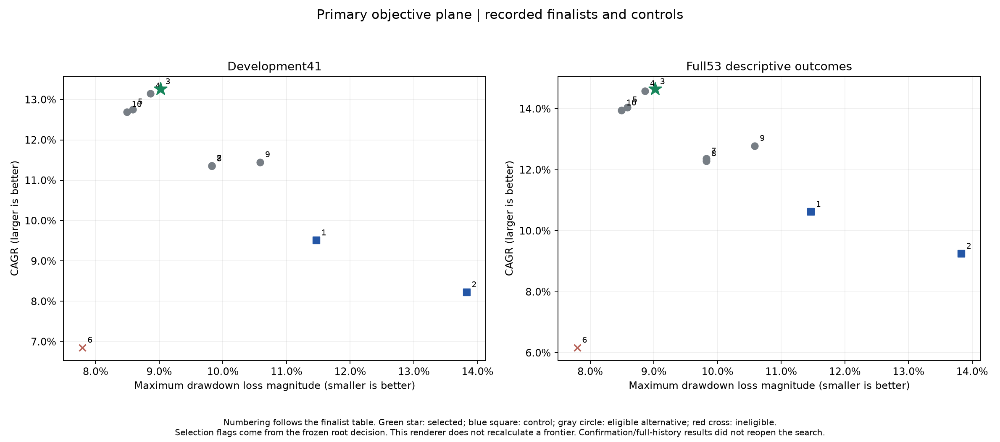
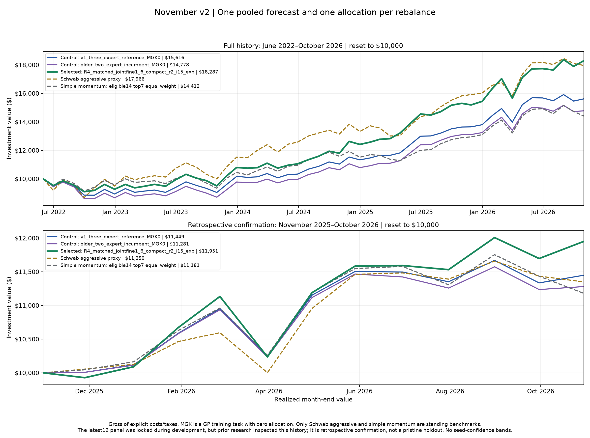
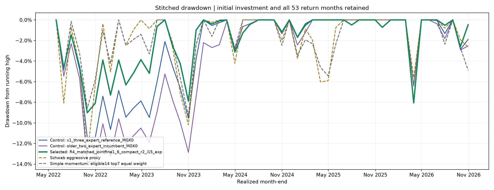

# November v2 matched policy comparison

Compounded return/CAGR and drawdown are the primary objectives. Conventional Sharpe and fourteen-ETF ranking IC are secondary evidence, with NLL/RMSE diagnostic. IC is not a veto that automatically discards a useful return/drawdown tradeoff. No turnover objective, CVaR, uncertainty recalibration, monthly discretionary blending, negative-return floor or previous-weight fallback is used.

Predictions and covariance are pooled equally across seeds 27, 127 and 227 before one allocation per month. The static family prediction blend and covariance recipe below apply across dates and seeds. MGK remains one of the 15 GP training tasks, receives exactly zero portfolio weight, and is excluded from the 14-ETF pooled/family ranking diagnostics. The allocator uses the eligible principal covariance.

Development includes all first 41 return months. The first five, June–October 2022, remain a partial diagnostic block and remain in every stitched wealth/drawdown path; they are not discarded. The three complete development blocks are November 2022–October 2023, November 2023–October 2024 and November 2024–October 2025. The latest12 block, November 2025–October 2026, was locked while this round's policies were developed and the shortlist/rule frozen. Older research already inspected these dates: final confirmation is retrospective, not a pristine independent holdout. No retuning follows it.

## November target concentration and conditional stress

**Current target concentration:** EWX is 45.206%; equities are 92.521% and fixed income 7.479%. HYEM alone is 7.479%. The selected policy's effective-count minimum is a concentration measure, not an equity/fixed-income balance. Under the two specified common-shock assumptions, the current targets return -18.88% and -28.88%, respectively. **Lower historical drawdown does not establish protection from a common future equity shock.**

Actual November effective assets are 3.57558, above the policy floor 3. The minimum raw optimizer weight is -7.53e-11, within the predeclared −1e−8 numerical tolerance; it is preserved without clipping or renormalization. The variance-ceiling ratio is 1.0000000013; the risk ceiling is active within the recorded numerical acceptance tolerance.

| Test                                                         | Period                                | Portfolio return / drawdown   | Scope                                                  |
|:-------------------------------------------------------------|:--------------------------------------|:------------------------------|:-------------------------------------------------------|
| Assumed equities −20%; all fixed income −5%                  | Hypothetical simultaneous asset shock | -18.88%                       | Conditional arithmetic loss; no assigned probability   |
| Assumed equities −30%; HYG/HYEM −15%; other fixed income −5% | Hypothetical simultaneous asset shock | -28.88%                       | Conditional arithmetic loss; no assigned probability   |
| November weights applied to March 2020                       | March 2020                            | -19.35%                       | Static historical sensitivity; no GP forecast          |
| Static monthly-reset path maximum drawdown                   | 2013-07–2026-10                       | -30.03%                       | Same November targets reset monthly throughout history |
| Worst static 1-month cumulative return                       | 2020-03–2020-03                       | -19.35%                       | Fixed November target historical sensitivity           |
| Worst static 3-month cumulative return                       | 2020-01–2020-03                       | -26.79%                       | Fixed November target historical sensitivity           |
| Worst static 12-month cumulative return                      | 2021-11–2022-10                       | -22.62%                       | Fixed November target historical sensitivity           |

The hypothetical rows apply the stated asset losses directly to the frozen November target weights. The historical rows reset those same targets monthly against adjusted total-return proxy history; they use no historical GP forecasts and are not a backtest of the GP allocation strategy. These conditional/static losses have no assigned probability, calibrated future-crash interpretation or assumed recovery path. They do not establish a personally acceptable loss tolerance. The frozen selection rule and constraints were maintained after inspecting the November weights and these diagnostics; no new selection or constraint was introduced.

Across the full53 months, the selected portfolio has mean squared standardized forecast error z²=2.674 and nominal95% interval coverage 83.02%; fixed eligible equal-weight z²=5.087, versus Gaussian reference values of 1 and 95%. This forecast-error/uncertainty mismatch can reflect mean and variance errors; it does not establish calibrated crash protection, and remains diagnostic without fitting, recalibration or selection changes.

- Historical prices are dividend/split-adjusted total-return proxies from the sealed October31 vintage.
- The same November target is reset monthly throughout history; no historical GP forecasts are used.
- Static historical sensitivity is gross of fees/taxes; November2 execution at October30 closes is not assumed.
- Shock2: HYG/HYEM receive-15%; BND/IEF/LQD/BNDX/VWOB receive-5%. Scenario buckets are not ratings.
- No probability, crash-protection guarantee, currency hedging or recovery path is inferred from these shocks.

[Distribution diagnostics](DISTRIBUTION_DIAGNOSTICS.md) and [machine-readable evidence](DISTRIBUTION_DIAGNOSTICS.json) examine predictive distributions only. They do not trigger fitting, uncertainty recalibration, a changed selection rule or another policy search.

## Frozen development decision and alternatives

{'confirmation_acceptance': {'all53_distance_gain_over_best_control_min': 0.05, 'complete_all53_and_November_raw_feasibility': True, 'confirmation12_distance_no_worse_than_best_control_plus': 0.5, 'confirmation12_drawdown_loss_no_worse_than_best_control_plus': 0.03, 'no_retuning_after_unlock': True}, 'development_eligibility': {'IC_noninferiority_veto': False, 'annual_blocks_no_worse_by_distance_0p25_min': 2, 'complete_raw_feasible_path': True, 'distance_gain_over_best_control_min': 0.05, 'leave_one_month_distance_gain_nonnegative_fraction_min': 0.8, 'paired_3month_bootstrap_distance_gain_nonnegative_fraction_min': 0.6, 'ten_bps_cost_distance_gain_min': -0.1}, 'final_selection': 'Eligible full53 Pareto minimum fixed-anchor distance; ties within1e-8 by development annual-block stability, Sharpe, eligible14IC, recipe complexity, ID. If no accepted challenger, best matched control by same full53 fixed-anchor distance.', 'frontier_stopping': {'HV_reference': 'reference_CAGR-0.10, reference_DDloss+0.10', 'budgets_are_ceilings_not_targets': True, 'consecutive_negligible_rounds': 2, 'minimum_tracks': ['cached policy investigation', 'allowed GP evidence assessment'], 'negligible_round': 'HV relative gain<1% AND best distance gain<0.05'}, 'normalization': {'CAGR_scale': 0.02, 'anchors_saved_once_before_new_policy_scoring': True, 'aspiration_CAGR': 'reference_CAGR + 0.02', 'aspiration_drawdown_loss': 'max(0, reference_drawdown_loss - 0.02)', 'distance': 'hypot(max(0,(aspiration_CAGR-CAGR)/0.02), max(0,(drawdown_loss-aspiration_drawdown_loss)/0.02))', 'drawdown_scale': 0.02, 'interpretation': 'Balanced operational aspiration, not a personal loss limit or promised return', 'source': 'MGK-free fixed v1 three-model reference development41 ONLY'}, 'primary': ['gross_CAGR', 'drawdown_loss_magnitude'], 'robustness': {'block_lengths': [3, 6], 'bootstrap_draws': 512, 'cost_bps': [0, 5, 10, 20], 'cost_gate_is_sensitivity_only': True, 'cost_objective': False, 'crash_probabilities_calibrated': False, 'seed': 20261101, 'seed_sensitivity_is_not_market_evidence': True, 'stress_drawdown_thresholds': [0.1, 0.15, 0.2]}, 'schema': 'bayesfolio.multiobjective.selection.v2', 'secondary': ['Sharpe', 'eligible14_rank_IC'], 'shortlist': {'mandatory_controls': 2, 'maximum': 10, 'remaining': 'Development eligible Pareto distance/stability plus return/defensive leaders and matched compact-rank pair when supported; deterministic ID ties'}}

Promote this fixed policy: it passed development robustness, the single retrospective confirmation and the full-history tradeoff gates. It is selected from the eligible return/drawdown Pareto set by fixed-anchor distance, annual-block stability, then conventional Sharpe/eligible14IC/simplicity. No November weight appearance or new tuning was used.

All 4 eligible Pareto candidates have fixed-anchor distance 0: each meets both one-sided aspirations. The final choice therefore used the frozen tie chain—development annual-block stability, conventional Sharpe, eligible14 ranking IC, then recipe simplicity/ID. The selected policy was not a unique CAGR/drawdown dominator.

| Configuration                               | Control   | Development CAGR   | Development drawdown   |   Frozen distance | Decision/status                                                                                                                   |
|:--------------------------------------------|:----------|:-------------------|:-----------------------|------------------:|:----------------------------------------------------------------------------------------------------------------------------------|
| v1_three_expert_reference_MGK0              | True      | 9.51%              | -11.47%                |           1.09495 | Eligible alternative                                                                                                              |
| older_two_expert_incumbent_MGK0             | True      | 8.22%              | -13.83%                |           2.45746 | Eligible alternative                                                                                                              |
| R4_matched_jointfine1_6_compact_r2_i15_exp  | False     | 13.26%             | -9.02%                 |           0       | Selected                                                                                                                          |
| R4_matched_jointfine1_12_compact_r2_i15_exp | False     | 13.15%             | -8.86%                 |           0       | Eligible alternative                                                                                                              |
| R4_matched_jointfine0_4_compact_r2_i15_exp  | False     | 12.76%             | -8.59%                 |           0       | Eligible alternative                                                                                                              |
| R3_cov0_[0, 0, 0, 1]_0.5                    | False     | 6.85%              | -7.80%                 |           2.67085 | Ineligible: all53_distance_gain_at_least_0p05, development_eligible_before_unlock, latest12_distance_within_best_control_plus0p50 |
| R4_matched_jointfine2_11_compact_r1_i15_exp | False     | 11.36%             | -9.82%                 |           0.17795 | Eligible alternative                                                                                                              |
| R4_matched_jointfine2_11_compact_r2_i15_exp | False     | 11.35%             | -9.82%                 |           0.17795 | Eligible alternative                                                                                                              |
| v1_three_expert_reference_MGK0_NE3_risk0.75 | False     | 11.45%             | -10.59%                |           0.55877 | Eligible alternative                                                                                                              |
| R4_matched_jointfine0_12_compact_r2_i15_exp | False     | 12.69%             | -8.49%                 |           0       | Eligible alternative                                                                                                              |

Eligible alternatives were not automatically selected. Exact recorded distances/gates, rather than a newly calculated objective ordering, explain the frozen decision.

## Development outcomes

| Configuration                               | CAGR   | Cumulative return   | Max drawdown   |   Sharpe |   14-ETF rank IC |   Mean effective assets | Worst month   |
|:--------------------------------------------|:-------|:--------------------|:---------------|---------:|-----------------:|------------------------:|:--------------|
| v1_three_expert_reference_MGK0              | 9.51%  | 36.40%              | -11.47%        |    0.473 |            0.104 |                   7     | -6.93%        |
| older_two_expert_incumbent_MGK0             | 8.22%  | 31.00%              | -13.83%        |    0.353 |            0.056 |                   7     | -8.52%        |
| R4_matched_jointfine1_6_compact_r2_i15_exp  | 13.26% | 53.02%              | -9.02%         |    0.777 |            0.101 |                   3.139 | -4.70%        |
| R4_matched_jointfine1_12_compact_r2_i15_exp | 13.15% | 52.52%              | -8.86%         |    0.769 |            0.098 |                   3.14  | -4.70%        |
| R4_matched_jointfine0_4_compact_r2_i15_exp  | 12.76% | 50.71%              | -8.59%         |    0.765 |            0.1   |                   3.311 | -4.70%        |
| R3_cov0_[0, 0, 0, 1]_0.5                    | 6.85%  | 25.41%              | -7.80%         |    0.299 |            0.097 |                   3.156 | -4.15%        |
| R4_matched_jointfine2_11_compact_r1_i15_exp | 11.36% | 44.44%              | -9.82%         |    0.628 |            0.082 |                   3.364 | -6.03%        |
| R4_matched_jointfine2_11_compact_r2_i15_exp | 11.35% | 44.38%              | -9.82%         |    0.626 |            0.086 |                   3.383 | -6.03%        |
| v1_three_expert_reference_MGK0_NE3_risk0.75 | 11.45% | 44.82%              | -10.59%        |    0.637 |            0.104 |                   3.272 | -5.99%        |
| R4_matched_jointfine0_12_compact_r2_i15_exp | 12.69% | 50.43%              | -8.49%         |    0.76  |            0.098 |                   3.315 | -4.70%        |

## Latest twelve-month retrospective confirmation

| Configuration                                 | CAGR   | Cumulative return   | Max drawdown   |   Sharpe | 14-ETF rank IC   | Mean effective assets   | Worst month   |
|:----------------------------------------------|:-------|:--------------------|:---------------|---------:|:-----------------|:------------------------|:--------------|
| v1_three_expert_reference_MGK0                | 14.49% | 14.49%              | -6.42%         |    0.79  | 0.285            | 7.000                   | -6.42%        |
| older_two_expert_incumbent_MGK0               | 12.81% | 12.81%              | -6.42%         |    0.679 | 0.192            | 7.000                   | -6.42%        |
| R4_matched_jointfine1_6_compact_r2_i15_exp    | 19.51% | 19.51%              | -8.06%         |    0.987 | 0.251            | 3.090                   | -8.06%        |
| R4_matched_jointfine1_12_compact_r2_i15_exp   | 19.60% | 19.60%              | -8.06%         |    0.993 | 0.237            | 3.090                   | -8.06%        |
| R4_matched_jointfine0_4_compact_r2_i15_exp    | 18.57% | 18.57%              | -8.06%         |    0.97  | 0.248            | 3.299                   | -8.06%        |
| R3_cov0_[0, 0, 0, 1]_0.5                      | 3.87%  | 3.87%               | -3.61%         |    0.025 | 0.247            | 3.063                   | -3.61%        |
| R4_matched_jointfine2_11_compact_r1_i15_exp   | 15.86% | 15.86%              | -8.06%         |    0.775 | 0.267            | 3.448                   | -8.06%        |
| R4_matched_jointfine2_11_compact_r2_i15_exp   | 15.55% | 15.55%              | -8.06%         |    0.759 | 0.264            | 3.440                   | -8.06%        |
| v1_three_expert_reference_MGK0_NE3_risk0.75   | 17.47% | 17.47%              | -8.06%         |    0.898 | 0.285            | 3.224                   | -8.06%        |
| R4_matched_jointfine0_12_compact_r2_i15_exp   | 18.33% | 18.33%              | -8.06%         |    0.955 | 0.243            | 3.276                   | -8.06%        |
| Simple momentum: eligible14 top7 equal weight | 11.81% | 11.81%              | -6.40%         |    0.581 | —                | —                       | -6.40%        |
| Schwab aggressive proxy                       | 13.50% | 13.50%              | -5.60%         |    0.748 | —                | —                       | -5.60%        |

## Full stitched 53-month outcomes

| Configuration                                 | CAGR   | Cumulative return   | Max drawdown   |   Sharpe | 14-ETF rank IC   | Mean effective assets   | Worst month   |
|:----------------------------------------------|:-------|:--------------------|:---------------|---------:|:-----------------|:------------------------|:--------------|
| v1_three_expert_reference_MGK0                | 10.62% | 56.16%              | -11.47%        |    0.562 | 0.145            | 7.000                   | -6.93%        |
| older_two_expert_incumbent_MGK0               | 9.25%  | 47.78%              | -13.83%        |    0.441 | 0.087            | 7.000                   | -8.52%        |
| R4_matched_jointfine1_6_compact_r2_i15_exp    | 14.64% | 82.87%              | -9.02%         |    0.838 | 0.135            | 3.128                   | -8.06%        |
| R4_matched_jointfine1_12_compact_r2_i15_exp   | 14.58% | 82.42%              | -8.86%         |    0.834 | 0.129            | 3.128                   | -8.06%        |
| R4_matched_jointfine0_4_compact_r2_i15_exp    | 14.05% | 78.70%              | -8.59%         |    0.825 | 0.133            | 3.308                   | -8.06%        |
| R3_cov0_[0, 0, 0, 1]_0.5                      | 6.17%  | 30.26%              | -7.80%         |    0.249 | 0.131            | 3.135                   | -4.15%        |
| R4_matched_jointfine2_11_compact_r1_i15_exp   | 12.36% | 67.35%              | -9.82%         |    0.671 | 0.123            | 3.383                   | -8.06%        |
| R4_matched_jointfine2_11_compact_r2_i15_exp   | 12.29% | 66.83%              | -9.82%         |    0.665 | 0.126            | 3.396                   | -8.06%        |
| v1_three_expert_reference_MGK0_NE3_risk0.75   | 12.78% | 70.13%              | -10.59%        |    0.713 | 0.145            | 3.261                   | -8.06%        |
| R4_matched_jointfine0_12_compact_r2_i15_exp   | 13.95% | 78.00%              | -8.49%         |    0.817 | 0.131            | 3.306                   | -8.06%        |
| Simple momentum: eligible14 top7 equal weight | 8.63%  | 44.12%              | -9.28%         |    0.388 | —                | —                       | -6.40%        |
| Schwab aggressive proxy                       | 14.19% | 79.66%              | -13.14%        |    0.676 | —                | —                       | -9.01%        |

Only Schwab aggressive and eligible-14 standalone simple momentum are standing benchmarks. Control model policies are research comparisons, not additional standing benchmarks.

## Primary objective plane



|   Figure number | Policy ID                   | Configuration                               |
|----------------:|:----------------------------|:--------------------------------------------|
|               1 | policy_c5f34924606d3b69f1bf | v1_three_expert_reference_MGK0              |
|               2 | policy_56a0b06b63cc63c2913b | older_two_expert_incumbent_MGK0             |
|               3 | policy_b71ce3fe84ee69f58247 | R4_matched_jointfine1_6_compact_r2_i15_exp  |
|               4 | policy_1ecb16e803d529c446d5 | R4_matched_jointfine1_12_compact_r2_i15_exp |
|               5 | policy_269c851205829f549e8e | R4_matched_jointfine0_4_compact_r2_i15_exp  |
|               6 | policy_bffebed65d9d74291d0a | R3_cov0_[0, 0, 0, 1]_0.5                    |
|               7 | policy_ffda294836ec0b34898d | R4_matched_jointfine2_11_compact_r1_i15_exp |
|               8 | policy_e88e9221e7d2bdd5631c | R4_matched_jointfine2_11_compact_r2_i15_exp |
|               9 | policy_91b4b9ebe70878b95ef8 | v1_three_expert_reference_MGK0_NE3_risk0.75 |
|              10 | policy_87884c01c87dcdace8a6 | R4_matched_jointfine0_12_compact_r2_i15_exp |

## Cumulative wealth and stitched drawdown





Each curve is one pooled forecast followed by one allocation per date. It is not an average of separately optimized seed portfolios. The latest12 wealth panel resets to $10,000; stitched drawdown retains the original investment peak and all 53 months.

## Selected policy robustness evidence

```json
{
  "10bps_cost_check": {
    "candidate_distance": 0.1420847725240477,
    "distance_gain": 1.919742814584268,
    "reference_distance": 2.061827587108316
  },
  "anchors": {
    "CAGR_scale": 0.02,
    "aspiration_CAGR": 0.11510412641221122,
    "aspiration_drawdown_loss": 0.09467996887355114,
    "drawdown_scale": 0.02
  },
  "annual_blocks_within_tolerance": 3,
  "annual_development_blocks": [
    {
      "candidate_distance": 4.037888261573108,
      "end_index_exclusive": 17,
      "reference_distance": 4.677963659697769,
      "start_index": 5,
      "within_reference_plus_0p25": true
    },
    {
      "candidate_distance": 0.0,
      "end_index_exclusive": 29,
      "reference_distance": 0.0,
      "start_index": 17,
      "within_reference_plus_0p25": true
    },
    {
      "candidate_distance": 0.0,
      "end_index_exclusive": 41,
      "reference_distance": 0.0,
      "start_index": 29,
      "within_reference_plus_0p25": true
    }
  ],
  "bootstrap": {
    "3": {
      "candidate_drawdown_exceedance_fractions": {
        "0.1": 0.3515625,
        "0.15": 0.0703125,
        "0.2": 0.015625
      },
      "candidate_percentiles": {
        "cagr": {
          "defined_replicates": 512,
          "median": 0.129586447944522,
          "p025": 0.029410317946539116,
          "p975": 0.24667393568430654,
          "undefined_replicates": 0
        },
        "max_drawdown": {
          "defined_replicates": 512,
          "median": -0.08497885482964207,
          "p025": -0.18161060222233424,
          "p975": -0.042505155258127814,
          "undefined_replicates": 0
        },
        "rank_ic": {
          "defined_replicates": 512,
          "median": 0.10469043151969981,
          "p025": -0.07502010184937014,
          "p975": 0.2778343607611899,
          "undefined_replicates": 0
        },
        "sharpe": {
          "defined_replicates": 512,
          "median": 0.7636225835459329,
          "p025": -0.0690180247487604,
          "p975": 1.7263347269006342,
          "undefined_replicates": 0
        }
      },
      "distance_gain": {
        "defined_replicates": 512,
        "median": 1.0607827966408552,
        "p025": -0.04230978685504077,
        "p975": 3.788167156322487,
        "undefined_replicates": 0
      },
      "distance_gain_fraction": 0.970703125,
      "paired_differences": {
        "block_length": 3,
        "difference_direction": "candidate_minus_reference; positive favors candidate",
        "draws": 512,
        "interpretation": "Retrospective sensitivity; empirical fractions are not future win probabilities",
        "method": "paired_circular_moving_block",
        "metrics": {
          "cagr": {
            "defined_replicates": 512,
            "fraction_above_zero": 1.0,
            "median": 0.03624216913661593,
            "p025": 0.013679844940834523,
            "p975": 0.06219037789173237,
            "point_difference": 0.03747891138299808,
            "undefined_replicates": 0
          },
          "max_drawdown": {
            "defined_replicates": 512,
            "fraction_above_zero": 0.7734375,
            "median": 0.01982624758667173,
            "p025": -0.0064883798359882195,
            "p975": 0.06388944715914091,
            "point_difference": 0.02449073797539092,
            "undefined_replicates": 0
          },
          "rank_ic": {
            "defined_replicates": 512,
            "fraction_above_zero": 0.443359375,
            "median": -0.0025194317877244715,
            "p025": -0.04162154918252481,
            "p975": 0.03944250871080139,
            "point_difference": -0.003001876172607874,
            "undefined_replicates": 0
          },
          "sharpe": {
            "defined_replicates": 512,
            "fraction_above_zero": 1.0,
            "median": 0.283261952144537,
            "p025": 0.09809264846012633,
            "p975": 0.5160971724657862,
            "point_difference": 0.303362318312367,
            "undefined_replicates": 0
          },
          "total_return": {
            "defined_replicates": 512,
            "fraction_above_zero": 1.0,
            "median": 0.16066718076304132,
            "p025": 0.05903210614114559,
            "p975": 0.29489883184221705,
            "point_difference": 0.16619510001577997,
            "undefined_replicates": 0
          }
        },
        "months": 41,
        "seed": 20261101
      },
      "positive_distance_gain_fraction": 0.7421875,
      "reference_drawdown_exceedance_fractions": {
        "0.1": 0.609375,
        "0.15": 0.173828125,
        "0.2": 0.0625
      },
      "reference_percentiles": {
        "cagr": {
          "defined_replicates": 512,
          "median": 0.09581861503971256,
          "p025": -0.011831938697292614,
          "p975": 0.20803348755410514,
          "undefined_replicates": 0
        },
        "max_drawdown": {
          "defined_replicates": 512,
          "median": -0.10335331527563424,
          "p025": -0.22378019664330615,
          "p975": -0.04614796781406813,
          "undefined_replicates": 0
        },
        "rank_ic": {
          "defined_replicates": 512,
          "median": 0.10919324577861161,
          "p025": -0.06742428303403913,
          "p975": 0.27386759581881515,
          "undefined_replicates": 0
        },
        "sharpe": {
          "defined_replicates": 512,
          "median": 0.48499958686108785,
          "p025": -0.4141140930364429,
          "p975": 1.4856275173901883,
          "undefined_replicates": 0
        }
      }
    },
    "6": {
      "candidate_drawdown_exceedance_fractions": {
        "0.1": 0.279296875,
        "0.15": 0.060546875,
        "0.2": 0.001953125
      },
      "candidate_percentiles": {
        "cagr": {
          "defined_replicates": 512,
          "median": 0.13200412092190528,
          "p025": 0.028868809519492594,
          "p975": 0.23526311899211336,
          "undefined_replicates": 0
        },
        "max_drawdown": {
          "defined_replicates": 512,
          "median": -0.09018923089816,
          "p025": -0.16407872105821844,
          "p975": -0.03706485313334796,
          "undefined_replicates": 0
        },
        "rank_ic": {
          "defined_replicates": 512,
          "median": 0.10024122219244169,
          "p025": -0.08187349236129723,
          "p975": 0.2964325917984451,
          "undefined_replicates": 0
        },
        "sharpe": {
          "defined_replicates": 512,
          "median": 0.7666617688070567,
          "p025": -0.06472037385440366,
          "p975": 1.7513970714381564,
          "undefined_replicates": 0
        }
      },
      "distance_gain": {
        "defined_replicates": 512,
        "median": 1.2444087834478514,
        "p025": 0.0,
        "p975": 3.8261961997303566,
        "undefined_replicates": 0
      },
      "distance_gain_fraction": 0.986328125,
      "paired_differences": {
        "block_length": 6,
        "difference_direction": "candidate_minus_reference; positive favors candidate",
        "draws": 512,
        "interpretation": "Retrospective sensitivity; empirical fractions are not future win probabilities",
        "method": "paired_circular_moving_block",
        "metrics": {
          "cagr": {
            "defined_replicates": 512,
            "fraction_above_zero": 1.0,
            "median": 0.037335707185242595,
            "p025": 0.01839117383414789,
            "p975": 0.056620841848630775,
            "point_difference": 0.03747891138299808,
            "undefined_replicates": 0
          },
          "max_drawdown": {
            "defined_replicates": 512,
            "fraction_above_zero": 0.740234375,
            "median": 0.024046785027863893,
            "p025": -0.007339697227050523,
            "p975": 0.06862198394942554,
            "point_difference": 0.02449073797539092,
            "undefined_replicates": 0
          },
          "rank_ic": {
            "defined_replicates": 512,
            "fraction_above_zero": 0.453125,
            "median": -0.0018761726078799362,
            "p025": -0.036689895470383274,
            "p975": 0.02966228893058158,
            "point_difference": -0.003001876172607874,
            "undefined_replicates": 0
          },
          "sharpe": {
            "defined_replicates": 512,
            "fraction_above_zero": 1.0,
            "median": 0.2891191070198458,
            "p025": 0.11330694658242256,
            "p975": 0.45807810213373495,
            "point_difference": 0.303362318312367,
            "undefined_replicates": 0
          },
          "total_return": {
            "defined_replicates": 512,
            "fraction_above_zero": 1.0,
            "median": 0.16041418582804257,
            "p025": 0.08633227898041075,
            "p975": 0.2727805375645571,
            "point_difference": 0.16619510001577997,
            "undefined_replicates": 0
          }
        },
        "months": 41,
        "seed": 20261101
      },
      "positive_distance_gain_fraction": 0.736328125,
      "reference_drawdown_exceedance_fractions": {
        "0.1": 0.625,
        "0.15": 0.17578125,
        "0.2": 0.0546875
      },
      "reference_percentiles": {
        "cagr": {
          "defined_replicates": 512,
          "median": 0.09492413161632052,
          "p025": -0.014624498985394871,
          "p975": 0.19096096962511971,
          "undefined_replicates": 0
        },
        "max_drawdown": {
          "defined_replicates": 512,
          "median": -0.11088645477350201,
          "p025": -0.2166706458305322,
          "p975": -0.0351460209348993,
          "undefined_replicates": 0
        },
        "rank_ic": {
          "defined_replicates": 512,
          "median": 0.09943714821763602,
          "p025": -0.08970785312248726,
          "p975": 0.31126239614044476,
          "undefined_replicates": 0
        },
        "sharpe": {
          "defined_replicates": 512,
          "median": 0.4780059443633497,
          "p025": -0.40727510546094403,
          "p975": 1.555764395238558,
          "undefined_replicates": 0
        }
      }
    }
  },
  "candidate_distance": 0.0,
  "candidate_id": "policy_b71ce3fe84ee69f58247",
  "confirmation_used": false,
  "distance_gain": 1.4142135623730954,
  "distance_gain_direction": "reference_minus_candidate; positive favors candidate",
  "draws": 512,
  "eligible": true,
  "fixed_reference_id": "policy_c5f34924606d3b69f1bf",
  "gates": {
    "10bps_distance_gain_at_least_minus_0p10": true,
    "at_least_two_annual_blocks_within_distance_0p25": true,
    "block3_distance_gain_fraction_at_least_0p60": true,
    "development_distance_gain_at_least_0p05": true,
    "feasibility_complete": true,
    "leave_one_month_out_distance_gain_fraction_at_least_0p80": true
  },
  "interpretation": "Resampled completed strategy returns are not refitted alternate histories; frequencies are retrospective descriptions, not future crash probabilities",
  "leave_one_month_out": {
    "distance_gains": [
      0.364661993197804,
      1.58484624467978,
      0.29504188603677245,
      0.0,
      1.3081715811899486,
      2.0646274639453637,
      1.0406008852583026,
      2.3611634049574133,
      1.0805115567392736,
      1.442914278538541,
      1.4107229152763372,
      1.1580431685755597,
      2.263381730634686,
      2.4186592055249263,
      1.0963874485859395,
      1.127500894602214,
      1.0582504081566544,
      1.9620362310688233,
      2.0410921636394628,
      1.2718008836475643,
      1.3596162633416604,
      1.6019921352539368,
      1.073562195327131,
      1.6003648844965912,
      1.3597312935476105,
      1.7395525359784971,
      1.5364618782181123,
      1.6694319210775683,
      1.1941635957676426,
      1.7842756733474907,
      1.1599782085956156,
      1.4667205627169648,
      1.5094964841756906,
      1.3297063230056125,
      1.5003548411566585,
      1.9267233290769459,
      1.925345501291092,
      1.3473988538036723,
      1.50007873940182,
      1.597624331953292,
      1.4368585206759623
    ],
    "minimum_gain": 0.0,
    "nonnegative_gain_fraction": 1.0,
    "positive_gain_fraction": 0.975609756097561
  },
  "months": 41,
  "reference_distance": 1.4142135623730954,
  "seed": 20261101,
  "selection_fraction_rule": "nonnegative gain >= -1e-12; descriptive positive fractions remain >0"
}
```

## Matched cost sensitivity: selected, controls and benchmarks

| Configuration                                 |   Cost (bps per traded dollar) | CAGR   | Cumulative return   | Max drawdown   |
|:----------------------------------------------|-------------------------------:|:-------|:--------------------|:---------------|
| v1_three_expert_reference_MGK0                |                              0 | 10.62% | 56.16%              | -11.47%        |
| v1_three_expert_reference_MGK0                |                             10 | 9.41%  | 48.74%              | -11.94%        |
| older_two_expert_incumbent_MGK0               |                              0 | 9.25%  | 47.78%              | -13.83%        |
| older_two_expert_incumbent_MGK0               |                             10 | 8.05%  | 40.78%              | -14.42%        |
| R4_matched_jointfine1_6_compact_r2_i15_exp    |                              0 | 14.64% | 82.87%              | -9.02%         |
| R4_matched_jointfine1_6_compact_r2_i15_exp    |                             10 | 12.74% | 69.80%              | -9.65%         |
| Simple momentum: eligible14 top7 equal weight |                              0 | 8.63%  | 44.12%              | -9.28%         |
| Simple momentum: eligible14 top7 equal weight |                             10 | 8.18%  | 41.51%              | -9.36%         |
| Schwab aggressive proxy                       |                              0 | 14.19% | 79.66%              | -13.14%        |
| Schwab aggressive proxy                       |                             10 | 14.14% | 79.37%              | -13.22%        |

The gross cumulative-return comparison is 82.87% selected versus 79.66% Schwab aggressive. At 10 bps per gross traded dollar it is 69.80% versus 79.37%; the selected policy's return edge reverses in that cost case. Its recorded maximum drawdown at 10 bps is -9.65%, versus -13.22% for Schwab. Costs remain the predeclared sensitivity check rather than a new selection objective; the frozen policy is unchanged.

## Selected policy cost sensitivity

|   Cost (bps per traded dollar) | Cumulative return   | CAGR   | Max drawdown   |   Sharpe |
|-------------------------------:|:--------------------|:-------|:---------------|---------:|
|                              0 | 82.87%              | 14.64% | -9.02%         |    0.838 |
|                             10 | 69.80%              | 12.74% | -9.65%         |    0.696 |
|                             20 | 57.66%              | 10.86% | -10.27%        |    0.554 |
|                              5 | 76.21%              | 13.69% | -9.33%         |    0.767 |

0/5/10/20 bps per gross traded dollar are diagnostic fixed-policy replays, not a turnover objective. Initial purchases are charged; subsequent trades use drifted pretrade holdings. No failed month or negative return is silently dropped or floored.

## Limitations

These are retrospective research paths, gross of explicit costs/taxes unless a cost row says otherwise. Development selection, temporal dependence, prior inspection and limited sample size constrain the strength of inference. Paired block-bootstrap ranges are sensitivity diagnostics, not calibrated future win probabilities or crash protection. Seed variation is numerical sensitivity, not independent market evidence. Better NLL or a more attractive November allocation does not prove future superiority.

## Registered design limitations

```json
[
  "Conservative post-registration metadata-only design restriction. Preserve all unclosed leaves, but do not promote or use them for rank attribution. Round4 promised full pair coverage; its16 unclosed exposure/covariance leaves are a documented coverage limitation, not erased or called complete rank experiments. Exact pairs are required for rank finalists.",
  "All earlier histories were inspected; confirmation is a locked retrospective replay, not pristine holdout.",
  "No documented kernel/prior malfunction was established. Low amplitude and reaching maxiter15 are not sufficient justification; no unsupported kernel/prior or feature/window/budget/rank search was run.",
  "The originalMGK dividend-adjustment vintage difference0.08247% is documented in v1; old history and macro vintages were not revised. Macro point-in-time vintage certification remains limited.",
  "Risk-matrix mixtures are declared allocation recipes, not calibrated Bayesian mixture distributions. Historical covariance's stored MGK diagonal is a noninvestable placeholder, never a conditional observation.",
  "Drawdown bootstrap/static-stress frequencies are not calibrated future crash probabilities."
]
```

Oct31 Saturday as-of uses Oct30 closing information to forecast November. Possible Nov2 execution has price/gap risk; an after-close decision cannot obtain a retrospective Oct30 fill.

See DECISION.md for the selected policy and all fifteen November target weights. Source/data/code hashes, raw moments/optimizer evidence and one-command verification are in the reproduction artifacts.
